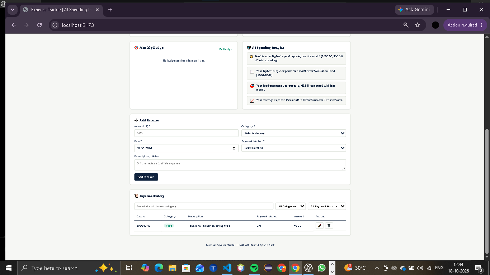

# 💸 Personal Expense Tracker with AI Spending Insights

A full-stack expense tracker built with **React (Vite)** on the frontend and
**Python Flask + SQLite** on the backend. Track expenses, set monthly budgets,
view category and daily spending charts, and get AI-generated spending insights
based on your real data.

---

## Project Structure

```
expense-tracker/
├── backend/
│   ├── app.py                  # Flask app + all REST API routes
│   ├── database.py             # SQLite connection, schema, sample data
│   ├── services/
│   │   └── ai_insights.py      # Rule-based AI spending insight generator
│   ├── requirements.txt
│   └── expenses.db             # created automatically on first run
│
├── frontend/
│   ├── src/
│   │   ├── components/
│   │   │   ├── Dashboard.jsx       # summary cards + highest expense
│   │   │   ├── ExpenseForm.jsx     # add/edit expense form
│   │   │   ├── ExpenseList.jsx     # searchable/filterable/sortable history table
│   │   │   ├── BudgetCard.jsx      # budget vs spend progress bar
│   │   │   ├── CategoryChart.jsx   # doughnut chart of category spending
│   │   │   ├── MonthlyChart.jsx    # daily spending bar chart
│   │   │   └── AIInsights.jsx      # AI insight cards
│   │   ├── services/api.js         # all fetch() calls to the backend
│   │   ├── App.jsx                 # top-level state + layout
│   │   ├── main.jsx
│   │   └── styles.css
│   ├── index.html
│   ├── package.json
│   └── vite.config.js
│
└── README.md
```

> **Note on structure:** the brief suggested splitting backend routes into
> `routes/expenses.py`, `routes/budget.py`, `routes/insights.py`. For this
> beginner-friendly build all routes live together in `backend/app.py` to keep
> imports simple and avoid any risk of broken cross-file references — the
> functionality (every endpoint, every feature) is complete either way. If you'd
> like it split into blueprints later, that's a straightforward refactor.

---

## Prerequisites

- **Python 3.9+**
- **Node.js 18+** and npm

---

## 1. Backend Setup (Python / Flask)

```bash
cd backend

# create and activate a virtual environment
python -m venv venv

# Windows
venv\Scripts\activate

# macOS / Linux
source venv/bin/activate

# install dependencies
pip install -r requirements.txt

# run the server
python app.py
```

The backend runs at **http://localhost:5000**.

On first run it will automatically:
- Create `expenses.db` (SQLite database)
- Create the `expenses` and `budgets` tables
- Insert **12 sample expenses** for the current month and a sample ₹30,000
  budget, so the dashboard and charts are populated immediately. (Sample data
  is only inserted once — if you already have expenses, it won't duplicate.)

## 2. Frontend Setup (React / Vite)

Open a **second terminal**:

```bash
cd frontend
npm install
npm run dev
```

The frontend runs at **http://localhost:5173** and talks to the backend at
`http://localhost:5000/api` (see `src/services/api.js`).

Open **http://localhost:5173** in your browser.

---

## Features

- **Add expenses** — amount, category, date, payment method, notes, with
  full client-side and server-side validation.
- **Category-wise spending** — table + doughnut chart, auto-updates on
  add/edit/delete.
- **Monthly total** — total spend, transaction count, average spend, with a
  month picker that refreshes every stat.
- **Budget comparison** — set a monthly budget; progress bar turns
  green → orange → red as you approach/exceed it, with a warning banner if
  exceeded.
- **Highest expense** — automatically identifies and displays the largest
  expense for the selected month.
- **AI Spending Insights** — a Python rule-based engine
  (`backend/services/ai_insights.py`) analyzes your real data and generates
  insights like "Shopping is your highest spending category this month",
  budget usage warnings, and month-over-month category comparisons. No
  external API key is required. If you want to plug in a real LLM later,
  there's a commented example at the bottom of that file — store the API key
  in an environment variable, never hardcode it.
- **Expense history** — search, filter by category/month/payment method,
  sort by date or amount, edit, and delete (with a confirm step) any expense.
- **Responsive UI** — works on desktop, tablet, and mobile.

---

## REST API Reference

| Method | Endpoint | Description |
|---|---|---|
| GET | `/api/expenses?month=&category=&payment_method=&search=&sort_by=&order=` | List expenses with filters |
| POST | `/api/expenses` | Create an expense |
| PUT | `/api/expenses/<id>` | Update an expense |
| DELETE | `/api/expenses/<id>` | Delete an expense |
| GET | `/api/dashboard?month=YYYY-MM` | Dashboard summary (totals, budget, highest expense, daily series) |
| GET | `/api/expenses/category-summary?month=YYYY-MM` | Category totals + percentages |
| GET | `/api/budget?month=YYYY-MM` | Get budget for a month |
| POST | `/api/budget` | Set/update budget for a month |
| GET | `/api/insights?month=YYYY-MM` | AI-generated spending insights |
| GET | `/api/meta` | Valid categories & payment methods |

All endpoints return JSON and proper HTTP status codes (`400` for validation
errors, `404` for missing resources, `500` for server errors).

---

## Database Schema

**expenses**
| column | type |
|---|---|
| id | INTEGER PK |
| amount | REAL (> 0) |
| category | TEXT |
| date | TEXT (YYYY-MM-DD) |
| payment_method | TEXT |
| description | TEXT |
| created_at | TEXT |

**budgets**
| column | type |
|---|---|
| id | INTEGER PK |
| month | TEXT (YYYY-MM, unique) |
| amount | REAL |
| created_at | TEXT |
| updated_at | TEXT |

Data persists in `backend/expenses.db` and survives app restarts.

---

## Troubleshooting

- **CORS errors in the browser console** — make sure the backend is running
  on port 5000; `flask-cors` is already configured in `app.py` to allow
  requests from the Vite dev server.
- **"Module not found: flask_cors"** — run `pip install -r requirements.txt`
  inside the activated virtual environment.
- **Port already in use** — change the port in `app.py` (`app.run(port=...)`)
  and update `API_BASE` in `frontend/src/services/api.js` to match.


---

---

## 📸 Project Screenshots

### 1. Project Dashboard


### 2. Project Interface


